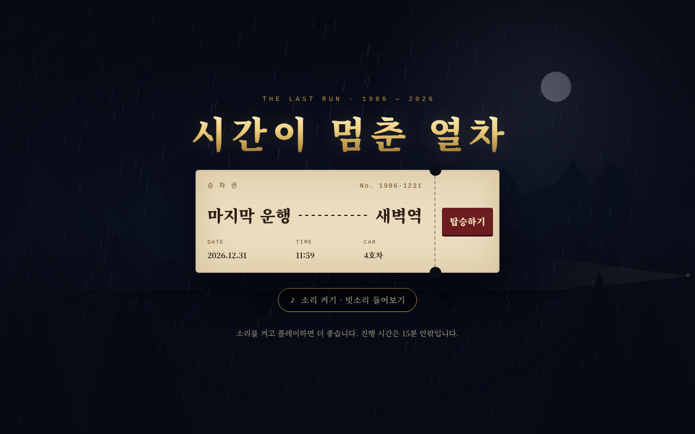
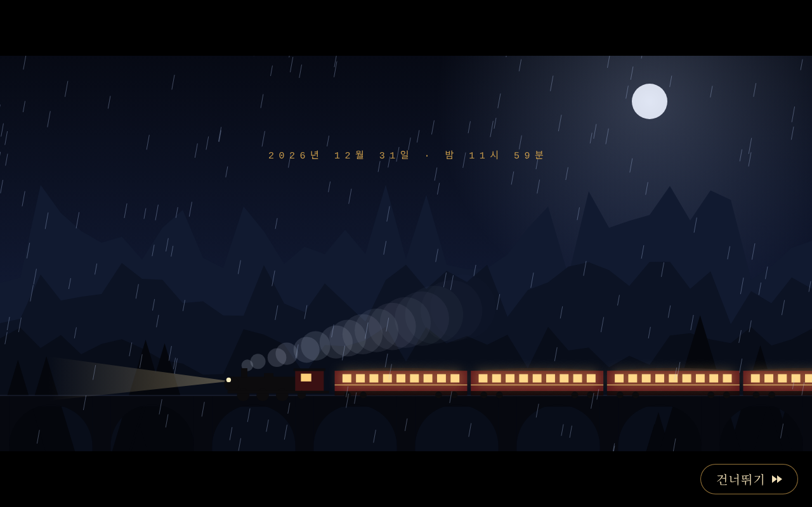
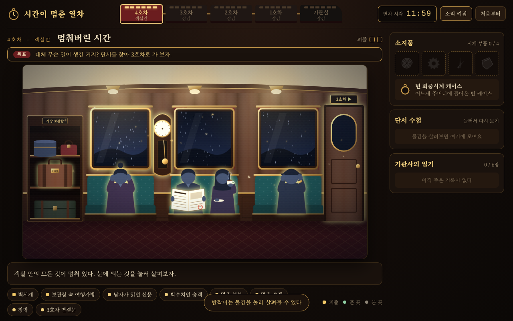
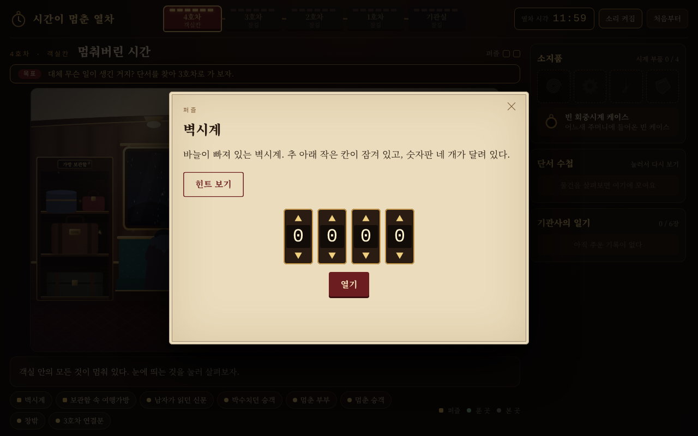

<h1 align="center">🚂 시간이 멈춘 열차</h1>

<p align="center">
  <b>THE LAST RUN · 1986 — 2026</b><br>
  자정 1분 전에 멈춰 버린 열차에서, 40년 동안 달린 기관사의 마지막 운행을 끝까지 이어 주는 웹 방탈출 게임
</p>

<p align="center">
  🎮 <a href="[게임 바로 가기](https://the-last-run.vercel.app/)"><b>지금 플레이하기</b></a> · 🔊 소리를 켜고 플레이하면 더 좋아요 · ⏱️ 약 15분
</p>

<p align="center">
  
</p>

<br>

## 📖 이야기

> 2026년 12월 31일, 밤 11시 59분.
> 오늘은 40년 동안 이 열차를 몰아 온 한시원 기관사의 마지막 운행일입니다.
> 객실에 축하 박수가 번지지만, 기관사는 창밖만 바라보며 오래된 회중시계를 꺼냅니다.
> 그리고 시계가 깨지는 순간, 열차 안의 모든 시간이 멈춥니다.

눈을 뜨면 박수를 치던 승객도, 창밖의 빗방울도 그대로 굳어 있습니다. 주머니에는 어느새 빈 회중시계 케이스가 들어 있습니다.

플레이어는 4호차에서 기관실까지 앞으로 나아가며 흩어진 **시계 부품 네 개**와 **기관사의 일기**를 모읍니다. 그러면서 기관사가 왜 슬퍼했는지, "윤정"은 누구인지 알게 됩니다. 시계를 다시 맞추면 멈췄던 시간이 흐르기 시작합니다.

<p align="center">
  
</p>

<br>

## 🗺️ 구성

각 칸은 하나의 장(章)입니다. 퍼즐을 풀어야 다음 칸으로 가는 문이 열립니다.

| 칸 | 부제 | 목표 |
| --- | --- | --- |
| 4호차 · 객실칸 | 멈춰버린 시간 | 무슨 일이 생겼는지 알아내기 |
| 3호차 · 식당칸 | 두 사람의 추억 | 두 사람은 어떤 사이였을까 |
| 2호차 · 객실칸 | 돌아오지 않는 사람 | 윤정에게 무슨 일이 있었을까 |
| 1호차 · 승무원칸 | 마지막 운행의 진실 | 기관사가 슬퍼한 이유와 마지막 편지 |
| 기관실 · 운전실 | 다시 흐르는 시간 | 시계를 고쳐 열차를 다시 달리게 하기 |

<p align="center">
  
</p>

<br>

## 🧩 퍼즐 설계

- **숫자 자물쇠 퍼즐 6개, 오르골 퍼즐, 회중시계 조립**으로 이루어져 있습니다.
- **단서가 칸을 넘어 이어집니다.** 한 칸에서 본 그림, 날짜, 물건이 다른 칸의 정답이 됩니다. 예를 들어 창밖에 보이는 별자리가 2호차 상자의 열쇠이고, 사진 속 인물의 옷과 소품 색깔이 오르골 퍼즐의 순서와 이어집니다.
- **숫자 하나하나가 이야기의 일부입니다.** 정답은 대부분 열차가 멈춘 시각이나 인물의 중요한 날짜처럼, 이야기 속에서 의미가 있는 숫자입니다.
- **막히면 힌트를 볼 수 있습니다.** 퍼즐마다 "힌트 보기" 버튼이 있고, 한 번 본 힌트는 다시 열어도 남아 있습니다.
- **단서 수첩과 일기장이 기록을 대신합니다.** 살펴본 단서는 오른쪽 수첩에 자동으로 모이고, 시계 부품을 얻을 때마다 기관사의 일기가 한 장씩 열립니다(총 6장). 일기를 읽고 나면 주인공이 한마디씩 떠올립니다.

<p align="center">
  
</p>

<br>

## ✨ 구현 특징

- **이미지·소리 파일 없이 코드만으로 만들었습니다.**
  - 객실, 승객, 회중시계, 인물 사진까지 모든 그림을 SVG로 직접 그렸습니다.
  - 효과음과 음악은 **Web Audio API로 합성**합니다. 빗소리, 열차 진동, 기적 소리, 문 여닫는 소리, 오르골, 자정 종소리, 그리고 인트로와 엔딩의 3박자 피아노곡까지 모두 코드로 연주합니다.
- **Canvas 연출**: 터널을 통과하는 오프닝, 비 내리는 밤 풍경과 고가교를 달리는 열차, 깨진 시계 파편이 공중에 멈춰 있는 장면, 엔딩에서 시간이 다시 흐르는 3단계 연출을 Canvas로 그립니다.
- **프레임워크 없이** HTML, CSS, JavaScript 세 파일(약 7,900줄)로 만들었습니다. 스크립트 전체를 즉시 실행 함수로 감싸 전역 변수를 만들지 않습니다.
- **여러 기기 지원**
  - PC, 태블릿, 휴대폰 화면에 맞게 배치가 바뀝니다. 휴대폰은 가로 화면을 기준으로 맞췄습니다.
  - 사파리처럼 사용자 입력 안에서만 소리를 허용하는 브라우저도 첫 터치로 소리가 켜지도록 처리했습니다.
  - `prefers-reduced-motion` 설정을 켠 사용자에게는 움직임을 줄여서 보여 줍니다.

<br>

## 🛠️ 만든 과정

`2026.11` · 웹페이지저작기초 수업 프로젝트

| 단계 | 내용 |
| --- | --- |
| 기획 | 시나리오, 인물, 칸별 이야기, 퍼즐 구조와 정답 흐름, 화면 구성을 직접 설계 |
| 구현 | 설계한 시나리오와 디자인을 바탕으로 **Claude와 함께 코드 작성** |
| 다듬기 | 칸별 소품과 조명, 효과음, 전환 연출, 엔딩을 여러 차례 보강하고 휴대폰 가로 화면 대응 |
| 정리 | 세 파일 코드 정리와 함수별 주석 작성 |

기능 단위로 브랜치를 나누고 Pull Request로 병합하며 작업했습니다.

<br>

## 🚀 실행

설치할 것이 없습니다. 레포를 내려받아 `index.html`을 브라우저로 열면 바로 플레이할 수 있습니다.

```bash
git clone https://github.com/seoyeon59/the-last-run.git
```

손글씨, 명조 글꼴은 Google Fonts에서 불러오므로 인터넷 연결이 필요합니다.

```text
the-last-run/
├── index.html   화면 뼈대 (타이틀 · 오프닝 · 게임 · 팝업)
├── style.css    객실 디자인, 연출 애니메이션, 반응형 배치
└── script.js    소리 합성, 그림, 캔버스 연출, 퍼즐 · 진행 로직
```

<br>

## 👥 만든 사람

| 이름 | 역할 |
| --- | --- |
| 전서연 | 기획 · 시나리오 · 퍼즐 설계 · 구현 |
| 박정원 | 구현 |
